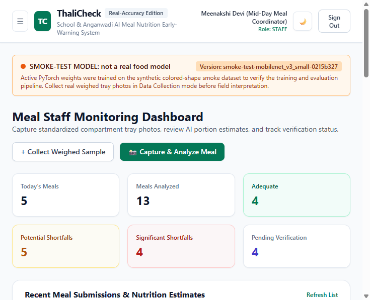
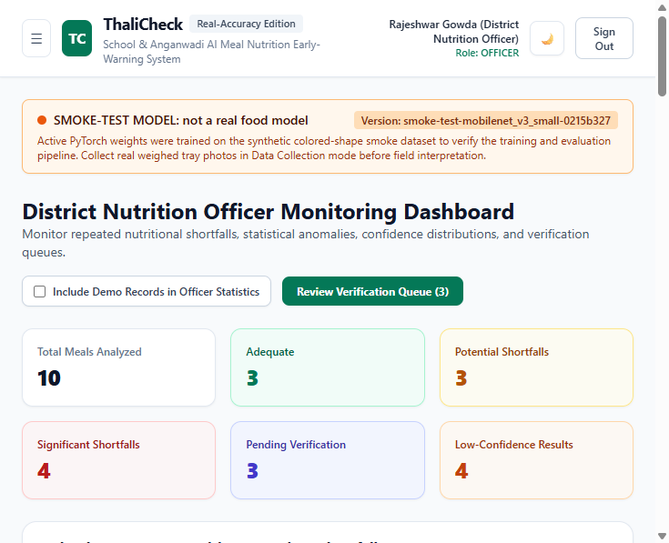
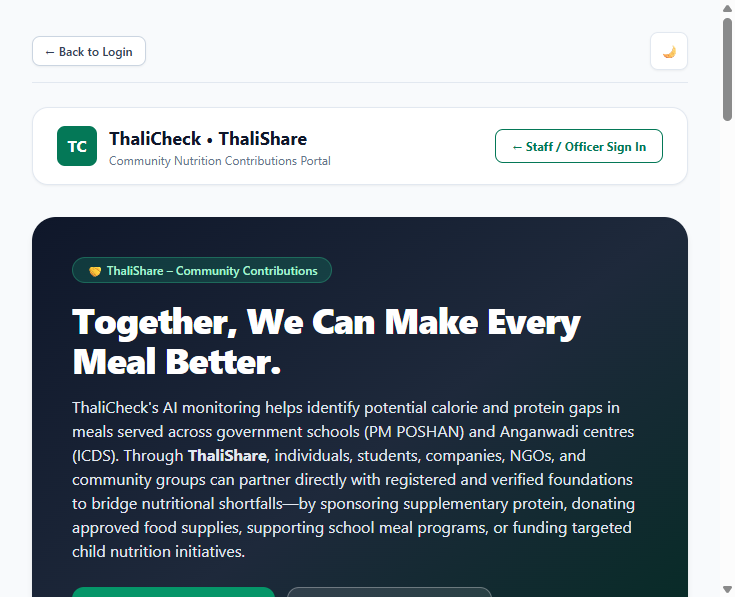
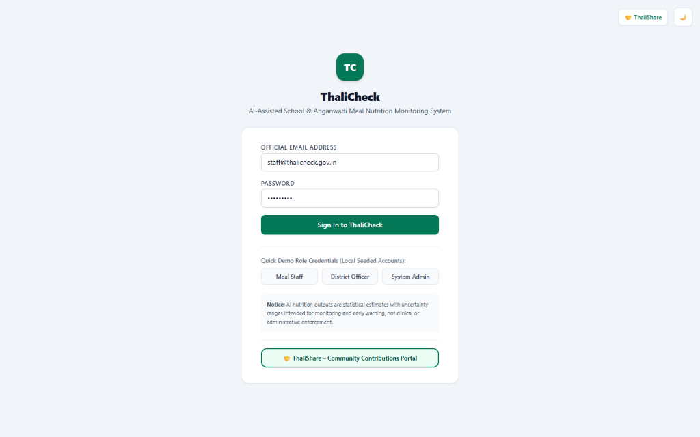

# ThaliCheck

> **AI-powered meal nutrition monitoring and early-warning system for Anganwadi centres and government schools.**

[](https://fastapi.tiangolo.com)
[](https://react.dev)
[](https://pytorch.org)
[](https://tailwindcss.com)
[](LICENSE)

---

## 📌 Short Description

**ThaliCheck** is a full-stack, local-first web application designed to monitor and manage nutritional quality in supplementary nutrition programs (ICDS Anganwadi) and school mid-day meals (PM POSHAN). 

Authorized ground staff capture a single photo of a served meal on a standardized 5-compartment thali tray carrying a high-contrast reference marker. ThaliCheck's computer vision pipeline validates image quality, localizes tray compartments, identifies food items, estimates portion weights as empirical uncertainty ranges, and checks calorie and protein content against government nutritional norms. Potential shortfalls trigger early-warning alerts for review by Sector and District Nutrition Officers.

> [!IMPORTANT]
> **Early-Warning & Non-Enforcement Mandate:**
> All AI outputs produced by ThaliCheck are **statistical estimates with confidence intervals**, not clinical diagnoses or legal violation findings. The system flags potential nutritional shortfalls for human verification and officer review to support ground staff, not for automated punitive action.

---

## 📸 Screenshots & UI Preview

| Staff Dashboard & Meal Submissions | District Officer Monitoring Dashboard |
| :---: | :---: |
|  |  |

| ThaliShare Community Portal | Login & Light/Dark Theme Support |
| :---: | :---: |
|  |  |

---

## ✨ Key Features

- 📸 **Standardized Tray & Computer Vision Pipeline (Zero OpenCV):**
  - Detects standardized 3.0 cm reference marker using NumPy, Pillow, and SciPy to calculate exact `pixels_per_cm` scale and tilt angle.
  - Image quality gate checks blur variance (Laplacian), brightness, and tray framing coverage with real-time retake guidance (*"Move closer"*, *"Image blurry"*, *"Too dark"*).
- ⚖️ **Portion & Calorie Estimation with Uncertainty Bounds:**
  - Converts compartment fill fraction and volume geometry to portion grams using empirical residual calibration models (`[low, likely, high]`).
  - Automatically flags items with insufficient calibration data as `uncalibrated`.
- 🛡️ **Measured-Accuracy & Transparent Safeguards:**
  - Zero invented or hard-coded accuracy numbers: metrics are pulled live from held-out evaluation reports.
  - Persistent model state banners distinguish between `DEMO MODE`, `SMOKE-TEST MODEL`, and `REAL MODEL`.
  - False-reassurance safeguard automatically routes low-confidence *"ADEQUATE"* meals to human verification.
- 📊 **Multi-Role Workflows & Dashboards:**
  - **Anganwadi Staff:** Fast photo capture, camera upload, portion review, and meal logging.
  - **Sector / District Officer:** Anomaly detection (IsolationForest + heuristics), school compliance trends, and human verification queue with food/portion correction workflows.
  - **State Administrator:** District monitoring, custom nutrition norm management, scale calibration, and immutable audit logs.
- 🤝 **ThaliShare – Community Contributions:**
  - Public portal allowing citizens, NGOs, and CSR sponsors to support child nutrition.
  - Directory of verified foundations, school adoption options, food grocery drives, and transparent impact tracking.
- 🌓 **Light & Dark Theme:**
  - Instant theme toggle persisted in `localStorage` with system preference detection and accessible high-contrast UI across all screens.

---

## 🛠️ Tech Stack

| Layer | Technologies |
| :--- | :--- |
| **Frontend** | React 18, Vite, Tailwind CSS, Recharts, React Router v6 |
| **Backend** | Python 3.10+, FastAPI, Uvicorn, Pydantic v2 |
| **AI / Data Science** | PyTorch, Torchvision (`MobileNetV3`, `EfficientNet`), NumPy, SciPy, Scikit-learn, Pandas |
| **Vision & Image Processing** | Pillow (PIL), SciPy Ndimage *(No OpenCV or heavy C++ bindings)* |
| **Database & ORM** | SQLAlchemy 2.0, Alembic, PostgreSQL *(with automated zero-config SQLite fallback)* |
| **Authentication & Security** | JWT (JSON Web Tokens), OAuth2 password bearer, Passlib / Bcrypt |
| **Testing** | Pytest, HTTPX, Vitest, React Testing Library |

---

## 🚀 5-Minute Quickstart Guide

Get ThaliCheck running locally in under 5 minutes without needing an external database setup.

### Prerequisites
- **Python:** 3.10, 3.11, or 3.12 ([Download Python](https://www.python.org/downloads/))
- **Node.js:** 18+ and npm ([Download Node.js](https://nodejs.org/))

---

### Step 1: Clone the Repository
```bash
git clone https://github.com/dhanyashree63/Anganwadi-Thali-Scanner.git
cd Anganwadi-Thali-Scanner
```

---

### Step 2: Start the Backend (Terminal 1)

The backend includes an automatic SQLite fallback, so you don't even need PostgreSQL installed to test immediately.

#### Windows (PowerShell):
```powershell
cd backend
python -m venv venv
.\venv\Scripts\Activate.ps1
python -m pip install -r requirements.txt

# Run migrations and seed demo data (users, schools, IFCT foods, recipes)
python -m alembic upgrade head
python ..\scripts\seed_demo_data.py

# Start FastAPI server on port 8000
python -m uvicorn app.main:app --reload --host 127.0.0.1 --port 8000
```

#### macOS / Linux:
```bash
cd backend
python3 -m venv venv
source venv/bin/activate
pip install -r requirements.txt

# Run migrations and seed demo data
alembic upgrade head
python3 ../scripts/seed_demo_data.py

# Start FastAPI server on port 8000
uvicorn app.main:app --reload --host 127.0.0.1 --port 8000
```

*The backend API will be live at `http://127.0.0.1:8000` (API Docs: `http://127.0.0.1:8000/docs`).*

---

### Step 3: Start the Frontend (Terminal 2)

In a new terminal window:
```bash
cd frontend
npm install
npm run dev
```

*The frontend application will be live at **`http://localhost:5173`**.*

---

## 🔑 Pre-Seeded Demo Accounts

You can test any role immediately using the seeded credentials:

| Role | Email | Password | Access & Purpose |
| :--- | :--- | :--- | :--- |
| **Anganwadi Staff** | `staff@thalicheck.gov.in` | `Staff@123` | Meal photo upload, AI scanner, nutrition summary |
| **Sector Officer** | `officer@thalicheck.gov.in` | `Officer@123` | School reviews, anomaly alerts, human verification queue |
| **System Admin** | `admin@thalicheck.gov.in` | `Admin@123` | Nutrition norm configuration, model training, audit trail |

*You can also click the quick one-click role buttons on the login screen to autofill credentials instantly.*

---

## 🧪 Running Tests

### Backend Unit & Integration Tests (12 Tests)
```bash
cd backend
.\venv\Scripts\Activate.ps1   # or source venv/bin/activate
pytest -v
```

### Frontend UI & Component Tests (8 Tests)
```bash
cd frontend
npm test
```

---

## 🌐 Community & Contributions (ThaliShare)

ThaliCheck includes an integrated community contribution module called **ThaliShare**:
- Navigate to **`http://localhost:5173/#/thalishare`** or click **🤝 ThaliShare** in the navigation header.
- View verified partner NGOs (e.g. Akshaya Patra Foundation, Annamrita Foundation).
- Submit sponsorship or grocery donation enquiries for local schools.

---

## 📄 License

This project is licensed under the MIT License — see the [LICENSE](LICENSE) file for details.
